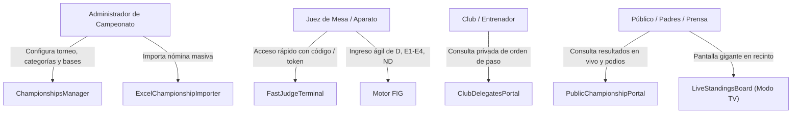
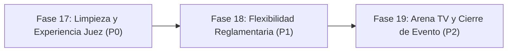

# OPERIX GYMNASTICS — DIAGNÓSTICO INTEGRAL DE PRODUCTO Y PLAN DE CONSOLIDACIÓN
**Documento Oficial de Auditoría y Planificación — Fase 16**  
**Fecha:** 13 de Noviembre de 2026  
**Autor:** Arquitecto de Software Senior, Product Manager, Especialista en Gimnasia Artística y QA Lead  
**Atribución:** Desarrollado por Comercial Hels SpA  
**Commit base:** `83259f3` en `main`  
**Estado de Validación Técnica:** 16 suites de tests exitosas (157/157 tests), TypeScript 0 errores, Oxlint 0 errores.

---

## 1. RESUMEN EJECUTIVO

Operix Gymnastics ha completado con éxito su fase de blindaje de seguridad, aislamiento multi-tenant y estandarización del motor de puntuación bajo las directrices de la **Fédération Internationale de Gymnastique (FIG) Ciclo Olímpico 2025-2028**. 

Habiéndose descartado la creación de un segundo entorno de staging en la nube para consolidar los esfuerzos en la arquitectura actual, esta auditoría evalúa el grado de madurez operativa y funcional del sistema para responder a una pregunta central:
> **¿Qué tan preparado está Operix Gymnastics para operar campeonatos reales de gimnasia artística de punta a punta, con cero improvisaciones en mesa de control, jueces, entrenadores y público?**

El diagnóstico revela que el **núcleo técnico y deportivo (reglas de cálculo, desempates, seguridad de tokens y generación de reportes) se encuentra en un estado excepcional y robusto**. Sin embargo, para convertir la aplicación en un producto comercial de estándar internacional, existen dependencias de datos demo/fallback que deben retirarse, optimizaciones críticas de flujo en la terminal de jueces (búsqueda rápida por dorsal) y adaptaciones reglamentarias para torneos formativos (número flexible de aparatos y desempates por equipos).

---

## 2. ETAPA 1 — AUDITORÍA DEL ESTADO ACTUAL

### 2.1. Arquitectura General y Tecnologías
- **Frontend:** React 19, TypeScript 5.9, Vite 5, Tailwind CSS v4, Lucide React.
- **Backend / Database:** PostgreSQL 15+ en Supabase, Supabase JS Client v2.45, Extensiones `pgcrypto` y `uuid-ossp`, Row-Level Security (RLS) en todas las tablas, WebSockets en tiempo real vía Postgres Changes.
- **Rutas y Navegación:** Enrutador SPA ligero (`src/lib/router.ts`) con soporte de URL limpias (`/`, `/evento/:slug`, `/club/rotaciones`, `/campeonatos`).
- **Estado Global:** Contextos aislados para Autenticación (`AuthContext`) y Tenancy (`OrganizationContext`).

### 2.2. Mapa de Módulos: Estado de Implementación

| Módulo / Funcionalidad | Componentes Clave | Estado | Diagnóstico Detallado |
| :--- | :--- | :---: | :--- |
| **Motor Deportivo FIG** | `scoringEngine.ts` | **Terminado** | Implementación completa de $D + E - ND$, descarte de extremos en paneles $\ge 4$ jueces, soporte GAF, GAM, GR, TRA, AER, ACRO, PK. Precisión a 3 decimales verificada en 157 tests. |
| **Desempates All-Around** | `standingsEngine.ts` | **Terminado** | Cumplimiento estricto del Art. 5.3 del Reglamento Técnico FIG: cascada de 5 pasos y empates ex-aequo compartiendo podio. Solo cuenta intento 1 de salto para AA. |
| **Terminal Rápida de Juez** | `FastJudgeTerminal.tsx` | **Parcial** | Seguridad sólida (`sessionStorage`, TTL 8h, purga de `localStorage`). **Faltante:** Selección de gimnasta mediante lista desplegable larga; carece de buscador rápido por número de dorsal (bib number). |
| **Consola Juez Árbitro** | `HeadJudgeView.tsx` | **Parcial** | Permite supervisar y aprobar notas (`official_approved`). **Faltante:** Registro formal de reclamos técnicos de nota D (Inquiries) con tiempo límite reglamentario. |
| **Tablero en Vivo** | `LiveStandingsBoard.tsx` | **Parcial** | Soporta WebSockets, 3 modos de vista (estándar, podio, arena/TV) e impresión. **Crítico:** Contiene fallback a datos demo (`getDemoSeedScores`) y nombres ficticios ante desconexión o tablas vacías. |
| **Importador Excel** | `ExcelChampionshipImporter.tsx` | **Terminado** | Parser flexible, preflight inteligente, detección de duplicados, soporte de año de nacimiento opcional (`birth_year`). |
| **Gestión de Campeonatos** | `ChampionshipsManager.tsx` | **Terminado** | Creación, edición, bases técnicas, categorías con régimen libre vs obligatorio, códigos de invitación y juez. |
| **Portal Público Evento** | `PublicChampionshipPortal.tsx` | **Terminado** | URL `/evento/:slug`. Exposición segura sin rotaciones privadas ni datos personales no autorizados. |
| **Portal Privado Clubes** | `ClubDelegatesPortal.tsx` | **Parcial** | Acceso a rotaciones mediante `get_my_club_rotations`. **Crítico:** Contiene fallback a gimnastas ficticias (`Catalina Rivas`) si la consulta devuelve vacío. |
| **Programación y Pista** | `CompetitionScheduleView.tsx` | **Parcial** | Matriz de rotaciones olímpicas, subdivisión y marshaling. **Faltante:** Control de retiro/baja de atletas en vivo (Scratch / No-Show). |
| **Premiación y Podios** | `AwardsManager.tsx`, `awardsEngine.ts` | **Terminado** | Reglas de pocos participantes (`strict_n_minus_one`), sincronización en tiempo real de ceremonias en arena (`arenaRealtimeProtocol.ts`). |
| **Documentación y Reportes** | `ReportsManager.tsx`, `reportsEngine.ts` | **Terminado** | Actas oficiales, libros de resultados (Result Book), diplomas personalizables por lotes y exportación CSV. |

---

## 3. ETAPA 2 — EVALUACIÓN FUNCIONAL DEPORTIVA

### 3.1. Evaluación Comparativa: Reglas Oficiales FIG vs. Realidad de Torneos
1. **Modalidades GAM (6 aparatos) y GAF (4 aparatos):**
   - El sistema define correctamente los aparatos estándar:
     - GAF: Salto (VT), Barras Asimétricas (UB), Viga de Equilibrio (BB), Suelo (FX).
     - GAM: Suelo (FX), Caballo con Arzones (PH), Anillas (SR), Salto (VT), Paralelas (PB), Barra Fija (HB).
   - **Hallazgo reglamentario:** En campeonatos formativos, escolares y de clubes (Niveles 1 al 5 USAG / Federados de Iniciación), las categorías infantiles frecuentemente compiten solo en 2 o 3 aparatos (ej. solo Suelo y Salto). Actualmente, el sistema calcula el All-Around sumando lo que encuentre, pero no permite al comité organizador definir formalmente cuántos y cuáles aparatos son obligatorios para disputar el All-Around en una categoría particular.
2. **Doble Salto de Caballo (Vault):**
   - La regla FIG exige que para la Final de Salto por Aparato se promedien 2 saltos de familias o fases de vuelo diferentes.
   - En All-Around solo cuenta el primer salto.
   - **Estado:** Esta regla está implementada a la perfección en `standingsEngine.ts` (`attempt !== 1 continue` para All-Around) y verificada en `vault-two-attempts-and-codes.test.ts`.
3. **Régimen Técnico: Libre FIG vs. Obligatorio (USAG / Escolar):**
   - En rutinas obligatorias no se evalúa dificultad ($D$), sino que la nota de partida es fija (ej. 10.000) y el juez únicamente deduce faltas de ejecución ($E$).
   - **Estado:** Totalmente implementado mediante el campo `scoring_regime` ('free' | 'obligatory') y `default_fixed_d_score`. La terminal de jueces se sincroniza automáticamente al seleccionar la categoría.
4. **Desempates por Equipos:**
   - La función `computeTeamStandings` actualmente suma linealmente las puntuaciones de todas las gimnastas del club.
   - **Pendiente reglamentario:** La mayoría de los torneos aplica el formato olímpico **5-4-3** (o 3 mejores notas por aparato por club). Si un club tiene 10 participantes en una categoría, sumar todos los puntajes distorsiona el resultado frente a clubes pequeños. Se requiere un parámetro de configuración: "Top N mejores notas por aparato cuentan para el equipo".

---

## 4. ETAPA 3 — EXPERIENCIA DE USUARIO (UX/UI AUDIT)

Evaluación de la interfaz bajo los cuatro perfiles operativos:

### 4.1. Perfil 1: Administrador de Campeonato (Mesa de Control)
- **Puntos Fuertes:** Gran agilidad para cargar 150+ gimnastas mediante el importador Excel con validación preflight y creación automática de clubes.
- **Oportunidad de Mejora:** El panel administrativo condensa demasiadas pestañas simultáneas en el menú superior (`championships`, `delegations`, `judging`, `schedule`, `standings`, `awards`, `reports`, `billing`). En una laptop de mesa de control, el scroll horizontal del menú resta agilidad. Se sugiere agrupar en: *Preparación*, *Competición en Vivo* y *Cierre & Premiación*.

### 4.2. Perfil 2: Juez de Aparato
- **Puntos Fuertes:** Terminal limpia, botones numéricos grandes, teclado optimizado para tablet táctil, cálculo en tiempo real de nota final antes de enviar.
- **Oportunidad Crítica de Mejora:** Actualmente, para calificar a una gimnasta, el juez debe buscarla en un `<select>` desplegable tradicional. En un torneo con 153 deportistas, seleccionar de una lista larga interrumpe el ritmo de la mesa de juzgamiento. **Solución requerida:** Teclado numérico con ingreso directo de Dorsal (ej. teclear `104` y presionar Enter para cargar a la atleta).

### 4.3. Perfil 3: Club, Delegado y Entrenador
- **Puntos Fuertes:** El portal privado (`/club/rotaciones`) ofrece privacidad absoluta. Ningún club puede ver datos ni estrategias de rivales.
- **Oportunidad de Mejora:** Los delegados necesitan una vista rápida para imprimir la "Ficha de Mi Delegación" con horarios aproximados de paso para repartir a los padres y entrenadores.

### 4.4. Perfil 4: Público, Padres y Aficionados
- **Puntos Fuertes:** El portal público (`/evento/:slug`) es visualmente profesional, responsivo y cumple con la protección de datos personales de menores.
- **Oportunidad de Mejora:** En smartphones, las tablas con muchas columnas (D, E, ND, Final) requieren desplazamiento horizontal. Se debe activar una vista "Card Compacta" para móviles donde prime la posición, medalla, club y nota final.

---

## 5. ETAPA 4 — MATRIZ DE PRIORIZACIÓN DE TRABAJO

| Prioridad | ID | Funcionalidad / Tarea | Justificación Operativa | Esfuerzo Estimado |
| :---: | :---: | :--- | :--- | :---: |
| **P0** | **P0-1** | **Erradicación de Datos Mock/Demo en Producción** | Eliminar los fallbacks hardcoded de `LiveStandingsBoard` (`Florencia Castro`) y `ClubDelegatesPortal` (`Catalina Rivas`). Reemplazar por estados vacíos elegantes ("Aún no hay puntuaciones oficiales registradas"). | Bajo |
| **P0** | **P0-2** | **Búsqueda por Dorsal (Bib Number) en Terminal de Jueces** | Agilizar el ingreso de notas permitiendo al juez tipear el dorsal de la gimnasta sin tener que buscar en un desplegable de 150 nombres. | Medio |
| **P0** | **P0-3** | **Soporte de All-Around con Aparatos Flexibles** | Permitir definir torneos o categorías formativas que compiten en 2 o 3 aparatos sin que el motor de All-Around exija la totalidad del ciclo olímpico. | Medio |
| **P1** | **P1-1** | **Regla de Puntuación por Equipos Configurable (Top N)** | Permitir que el cómputo por clubes sume únicamente las mejores 3 notas por aparato (formato estándar de clubes) en vez de sumar todas las gimnastas. | Medio |
| **P1** | **P1-2** | **Gestión de Asistencia en Pista (Scratch / Retiro)** | Marcar gimnastas que no se presentan o sufren lesiones antes de la rotación para no dejar la mesa de jueces esperando a una atleta ausente. | Bajo |
| **P1** | **P1-3** | **Vista Móvil Adaptativa (Cards) en Tablero de Resultados** | Optimizar la visualización en teléfonos de padres de familia sin necesidad de scroll horizontal. | Medio |
| **P1** | **P1-4** | **Impresión de Ficha de Acreditación por Club** | Generar un PDF o vista imprimible con el orden de paso y dorsales exclusivo para el delegado del club. | Bajo |
| **P2** | **P2-1** | **Modo Rotación Automática en Pantalla de Arena (Totem TV)** | Carrusel que alterne automáticamente cada 15 segundos entre el All-Around y las finales por aparato para pantallas gigantes sin operador. | Medio |
| **P2** | **P2-2** | **Módulo de Reclamos Técnicos (Inquiries) para Juez Árbitro** | Registro de apelaciones de nota D con cronómetro de 15 minutos reglamentarios y resolución documentada. | Alto |
| **P2** | **P2-3** | **Descarga de Result Book en PDF Nativo** | Compilación directa en archivo PDF descargable para archivo federativo, complementando la versión de impresión web existente. | Alto |
| **P3** | **P3-1** | **Integración con Pantallas LED de Marcador (Scoreboard Protocol)** | Envío de notas vía protocolo abierto a marcadores físicos de pista. | Alto |
| **P3** | **P3-2** | **Overlays Gráficos para Transmisión en Vivo (OBS / Streaming)** | Gráficos limpios con canal alfa para retransmisiones por YouTube / streaming del evento. | Alto |

---

## 6. ETAPA 5 — PLAN DE IMPLEMENTACIÓN SECUENCIAL

Para consolidar el producto sin rehacer código funcional, proponemos la siguiente secuencia estructurada:

### FASE 17 (Próxima Fase Sugerida): LIMPIEZA DE DEMOS Y OPTIMIZACIÓN DE JUECES (P0)
- **Objetivo:** Garantizar que la interfaz nunca muestre información ficticia ante estados vacíos y dotar a los jueces de una terminal ultra-rápida con búsqueda por dorsal.
- **Módulos involucrados:**
  - `src/features/standings/LiveStandingsBoard.tsx` (reemplazo de `getDemoSeedScores` por componente `EmptyState`).
  - `src/features/delegates/ClubDelegatesPortal.tsx` (reemplazo de fallbacks locales por aviso de "No hay rotaciones programadas").
  - `src/features/scoring/FastJudgeTerminal.tsx` (incorporación de input directo de Dorsal / Bib Number con tecla Enter, atajos de teclado y sugerencia de la siguiente atleta en orden).
- **Dependencias:** Ninguna (código cliente exclusivamente).
- **Pruebas de Aceptación:**
  1. Con base de datos vacía o sin notas, el tablero muestra "Esperando primeras calificaciones oficiales" sin referencias a "Camila Valenzuela" ni "Florencia Castro".
  2. En la terminal de juez, al digitar un dorsal existente (ej. `104`), la atleta correspondiente se selecciona instantáneamente.
  3. Los 157 tests unitarios y de integración continúan pasando al 100%.
- **Riesgos:** Ninguno en base de datos. Riesgo bajo de UI controlado por tests.

---

### FASE 18: FLEXIBILIDAD REGLAMENTARIA Y GESTIÓN EN PISTA (P1)
- **Objetivo:** Adaptar el motor deportivo para torneos escolares/formativos (All-Around de 2 o 3 aparatos) y regla de puntuación por equipos (Top 3 por aparato).
- **Módulos involucrados:**
  - `src/features/standings/standingsEngine.ts` (parámetros de cálculo para equipos y All-Around parcial).
  - `src/features/schedule/CompetitionScheduleView.tsx` (acción de "Retiro / Scratch" para saltar atleta ausente).
  - `src/features/public-portal/PublicChampionshipPortal.tsx` (vista de tarjeta para smartphones).
- **Pruebas de Aceptación:** Pruebas unitarias adicionales en Vitest validando desempate de equipos con regla Top 3 y cálculo de All-Around con 2 aparatos.

---

### FASE 19: MODO ARENA TV, RECLAMOS Y DOCUMENTACIÓN DEFINITIVA (P2)
- **Objetivo:** Dotar a la aplicación de capacidad para operar la pantalla gigante del gimnasio de forma autónoma y formalizar el flujo de reclamos técnicos.
- **Módulos involucrados:**
  - `src/features/standings/LiveStandingsBoard.tsx` (modo carrusel automatizado de arena).
  - `src/features/views/HeadJudgeView.tsx` (panel de Inquiries).
  - `src/features/reports/reportsEngine.ts` (emisión de Result Book oficial consolidado).

---

## 7. CONCLUSIÓN Y PROPUESTA DE SIGUIENTE PASO

Operix Gymnastics se encuentra en un **85% de completitud para operación real**. La arquitectura técnica, el motor deportivo y la seguridad son de primer nivel.

Para avanzar de forma segura, respetando la regla de no modificar producción ni alterar datos del campeonato Paillaco:
> **Se recomienda autorizar la ejecución de la FASE 17 (P0)**, enfocada exclusivamente en:
> 1. Erradicar los fallbacks mock/demo de `LiveStandingsBoard` y `ClubDelegatesPortal`.
> 2. Agregar búsqueda rápida por Dorsal (Bib Number) y atajos táctiles en la terminal de jueces (`FastJudgeTerminal`).
> 3. Verificar localmente la suite de pruebas y compilación limpia.

*Documento elaborado y validado para Operix Gymnastics — Comercial Hels SpA.*
